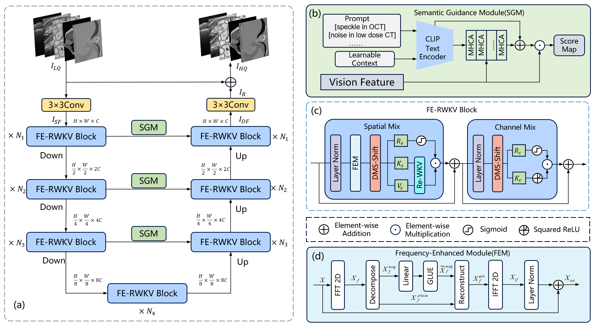

# SGF_RWKV

RWKV-based U-Net for unified medical image restoration across five modalities: speckle in OCT, speckle in ultrasound, noise in cryo-EM, noise in low-dose CT, and Gaussian noise in MRI.



### Key modules

- **DilatedMultiScaleShift** (DMS) — multi-scale depthwise-separable convolutions with learnable branch fusion
- **FrequencyEnhancementModule** (FEM) — polar-coordinate FFT with magnitude processing and phase preservation
- **SemanticGuidedScoreMap** (SGM) — cross-modal degradation-aware attention via frozen CLIP text encoder

All built on a U-Net backbone with bidirectional WKV linear-attention spatial mixing.

## Project structure

```
SGF_RWKV/
├── train.py                    # Training script
├── test.py                     # Evaluation script
├── sgf_rwkv/
│   ├── model.py                # SGF_RWKV model
│   ├── clip_encoder.py         # CLIP text encoder + context decoder (for SemanticGuidedScoreMap)
│   ├── wkv.py                  # WKV CUDA kernel wrapper
│   └── cuda/
│       ├── wkv_cuda.cu
│       └── wkv_op.cpp
├── data/
│   └── dataset.py              # DataLoaders + balanced modality sampler
├── utils/
│   ├── common.py               # Seeding, directory utilities
│   ├── metrics.py              # PSNR / SSIM / RMSE
│   ├── checkpoint.py           # Checkpoint save/resume/best tracking (with RNG state)
│   └── logger.py               # TensorBoard + per-modality txt logs
├── scripts/
│   └── download_clip_weights.py
├── figs/
│   └── architecture.png        # Network architecture diagram
├── supplementary/
│   └── SGF_RWKV_supplementary.pdf
├── requirements.txt
└── README.md
```

## Quick start

### 1. Install dependencies

```bash
pip install -r requirements.txt
```

### 2. Download CLIP weights

```bash
python scripts/download_clip_weights.py
```

### 3. Prepare data

Organise data as follows (`.raw` files: float32):

```
<data_root>/
  speckle in OCT/{train,val,test}/{LQ,HQ}/*.raw
  speckle in ultra sound/ ...
  noise in cryo-EM image/ ...
  noise in low dose CT/ ...
  Gaussian noise in MRI/ ...
```

### 4. Train

```bash
python train.py --data /path/to/data --gpus 0,1 --bs 4
python train.py --resume                    # Resume from checkpoint
```

Checkpoints are saved to `experiments/sgf_rwkv/checkpoints/` (latest + best PSNR/SSIM/RMSE).

### 5. Test

```bash
python test.py --data /path/to/data
python test.py --ckpt experiments/sgf_rwkv/checkpoints/best_psnr.pth
python test.py --modality "noise in low dose CT" --split val
python test.py --save_score_map             # Save score-map visualisations
```

Outputs are written to `experiments/sgf_rwkv/test_results/` — per-modality per-sample metrics + horizontal [input | output | label] strips.

### 6. TensorBoard

```bash
tensorboard --logdir experiments/sgf_rwkv/logs
```

## Supplementary Material

Supplementary material for the paper is available [here](supplementary/SGF_RWKV_supplementary.pdf).

## Acknowledgement

We thank OpenAI for the pretrained CLIP model (ViT-B/32) used in SemanticGuidedScoreMap, and the RWKV community for the CUDA WKV kernel.

The overall RWKV-based U-Net pipeline follow the design of Restore-RWKV [1].

[1] Z. Yang, J. Li, H. Zhang, D. Zhao, B. Wei, and Y. Xu, "Restore-RWKV: Efficient and effective medical image restoration with RWKV," *IEEE Journal of Biomedical and Health Informatics*, vol. 30, no. 1, pp. 513–526, 2026.
